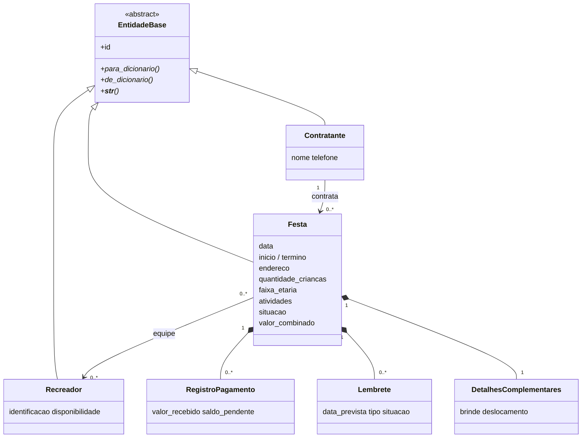

# Rastreabilidade: requisitos → modelagem UML → código → testes

Documento de apoio à avaliação (critério 7.1). Fonte dos requisitos e do diagrama:
**SRS 1.1** (`documentos/referencia/SRS_revisada.pdf`), PRD e Documento de Visão da TED 03 de
Análise e Engenharia de Sistemas.

## 1. Diagrama de Classes UML (Figura 3 da SRS) → código

Diagrama original (conceitual): `Contratante(nome, telefone)` 1—0..* `Festa(data, início/término,
endereço, quantidade/faixa etária, atividades, situação, valor combinado)`;
`Festa` 0..*—0..* `Recreador(identificação, disponibilidade)`;
`Festa` 1—0..* `Registro de pagamento(valor recebido, saldo pendente)`;
`Festa` 1—0..* `Lembrete(data prevista, tipo, situação)`;
`Festa` 1—0..1 `Detalhes complementares(brinde, deslocamento)`.

| Classe do UML | Código | Atributos do UML | Relacionamento implementado |
|---|---|---|---|
| Contratante | `modelos/contratante.py` · `Contratante` | `nome`, `telefone` | **Associação** 1—0..* com Festa: `Festa.contratante` guarda a referência; o contratante sobrevive sem festas |
| Festa | `modelos/festa.py` · `Festa` | `data`, `inicio`/`termino`, `endereco`, `quantidade_criancas`/`faixa_etaria`, `atividades`, `situacao`, `valor_combinado` | Centro do diagrama |
| Recreador | `modelos/recreador.py` · `Recreador` | `identificacao`, `disponibilidade` | **Associação** 0..*—0..* com Festa: `Festa.recreadores` (lista de referências; o mesmo recreador aparece em várias festas) |
| Registro de pagamento | `modelos/pagamento.py` · `RegistroPagamento` | `valor_recebido`, `saldo_pendente` | **Composição** 1—0..*: criado só por `Festa.registrar_pagamento`; faz parte do ciclo de vida da festa |
| Lembrete | `modelos/lembrete.py` · `Lembrete` | `data_prevista`, `tipo`, `situacao` | **Composição** 1—0..*: criado pelo serviço de avisos e cancelado junto com a festa (`Festa.cancelar`) |
| Detalhes complementares | `modelos/detalhes.py` · `DetalhesComplementares` | `brinde`, `deslocamento` | **Composição**: `Festa.detalhes` |

## 2. Alterações em relação ao UML (registro e justificativa)

O código **não remove nem renomeia** nenhuma classe ou atributo do diagrama aprovado.
As diferenças abaixo são acréscimos ou refinamentos necessários para implementar os requisitos.

| # | Alteração | Justificativa |
|---|---|---|
| A1 | Classe abstrata `EntidadeBase` (id + serialização) acima de Contratante, Recreador e Festa | O UML conceitual não mostra herança. A base abstrata aplica abstração/herança/polimorfismo da atividade e evita repetir identificador e conversão para JSON. Não altera o domínio |
| A2 | Enumerações `SituacaoFesta`, `TipoLembrete`, `SituacaoLembrete`, `TipoConflito` | Os atributos `situacao` e `tipo` do UML recebem valores fechados definidos na SRS (RF-03: confirmada, realizada, quitada, cancelada; RF-08/RN-09: tipos de aviso) |
| A3 | Objetos de valor `FaixaEtaria` e `Atividade` para os atributos "faixa etária" e "atividades" de Festa | Dar tipo e validação a atributos que o UML lista como texto. `Atividade` tem indicação etária opcional, só para alertar (RN-01) |
| A4 | `RegistroPagamento` ganha `data_pagamento`; `Lembrete` ganha `data_envio`; `Festa` ganha `data_confirmacao`, `data_cancelamento`, `credito_retido`, `credito_valido_ate` | Necessários para RF-06 (histórico), RF-08 (marcar envio manual), RN-09 (calcular avisos a partir da confirmação) e RN-03 (valor retido por 1 ano) |
| A5 | Cardinalidade Festa—Detalhes implementada como **1..1** (UML: 1..0..1) | RF-02 lista brindes/benefícios e deslocamento como campos **obrigatórios** da festa; sem eles o cadastro é impedido. Quando não há, informa-se "não se aplica" (pendência registrada na SRS, itens 19 e 21) |
| A6 | `Armazenamento`, `Repositorio`/`RepositorioJSON`/`RepositorioMemoria`, serviços e `Sistema` | Camadas de persistência e regras de negócio, previstas na atividade (src/modelos, servicos, persistencia). Não existem no diagrama conceitual, que "não representa projeto de banco de dados aprovado" |
| A7 | `Agenda` (coleção ordenada de festas com `__len__`, `__iter__`, `__contains__`) | Materializa o "exibir eventos em agenda" do RF-03 |
| A8 | Festa não é excluída: apenas **cancelada**. Contratante e recreador não são excluídos se constam em festas | O histórico financeiro e o crédito de cancelamento (RN-03) dependem deles. A SRS não prevê exclusão de festas |

## 3. Requisitos funcionais → código → testes

| Requisito | Implementação | Testes (pytest) |
|---|---|---|
| **RF-01** Contratantes: cadastro e busca por nome/telefone | `ServicoContratante.cadastrar/buscar` · `Contratante` | `test_servicos.py::TesteServicoContratante` (**CT-01**), `test_modelos.py::TesteContratante` |
| **RF-02** Festa com campos obrigatórios | `ServicoFesta.agendar` (`CampoObrigatorioErro`) · `Festa` | `TesteAgendarFesta` (**CT-02**), `TesteFestaCriacaoEValidacao` |
| **RF-03** Agenda e situação | `ServicoAgenda`, `Agenda`, `Festa.marcar_realizada/cancelar`, quitação automática | `TesteAgenda` (**CT-03**), `TesteFestaSituacao`, `TesteSituacaoServico` |
| **RF-04** Recreadores, conflitos de horário | `ServicoRecreador`, `ServicoEscala.verificar/alocar` | `TesteEscala` (**CT-04**), `TesteServicoRecreador` |
| **RF-05** Crianças e atividades | `Festa.quantidade_criancas/faixa_etaria/atividades`, `ServicoFesta.atualizar_criancas_e_atividades` | `TesteCriancasEAtividades` (**CT-05**) |
| **RF-06** Valores e pagamentos | `Festa.registrar_pagamento`, `entrada_prevista`, `saldo_pendente`, `ServicoFinanceiro` | `TesteFinanceiro` (**CT-06**), `TesteFestaValores` |
| **RF-07** Benefícios e deslocamento | `DetalhesComplementares`, `ServicoFesta.atualizar_detalhes` | `TesteDetalhes` (**CT-07**) |
| **RF-08** Avisos | `ServicoLembrete`, `regras_aviso.py` | `TesteAvisos` (**CT-08**) |
| **RF-08** + remarcação | `ServicoFesta.remarcar` → `ServicoLembrete.refazer` | `TesteRemarcacao` (**CT-09**) |
| **RF-09** Resumo do evento | `ServicoResumo.gerar`, `ResumoEvento` | `TesteResumo` (**CT-10**) |

## 4. Regras de negócio → código → testes

| Regra | Como foi implementada | Testes |
|---|---|---|
| **RN-01** atividades × faixa etária | `Atividade.adequada_para`, alerta no resumo (sem lista fixa por idade, como informado) | `test_rn01_alerta_quando_atividade_nao_serve_para_a_faixa` |
| **RN-02** entrada de 50%; data reservada só após a entrada | `Festa.entrada_prevista`, `entrada_paga`, `data_reservada` | `test_data_reservada_somente_apos_entrada`, `test_data_so_fica_reservada_apos_a_entrada` |
| **RN-03** cancelamento: valor retido, uso em até 1 ano | `Festa.cancelar`, `ServicoFinanceiro.creditos_retidos` | `test_cancelamento_retem_valor_por_um_ano`, `test_festa_cancelada_sai_do_a_receber_e_vira_credito` |
| **RN-04** remarcação caso a caso | `Festa.remarcar` (só registra a nova data; sem taxa nem prazo automáticos) | `TesteRemarcacao` |
| **RN-05** seis recreadores; festas simultâneas com equipe suficiente | Sem limite de festas simultâneas; só conflitos por recreador | `test_ct04_festas_simultaneas_com_equipes_distintas` |
| **RN-06** dimensionamento informado | `modelos/dimensionamento.py` (tabela literal, sem extrapolar) | `TesteDimensionamento`, `test_dimensionamento_alerta_*` |
| **RN-07** intervalo mínimo de 60 min | `ServicoEscala.verificar_janela` (`INTERVALO_MINIMO`) | `test_intervalo_minimo_de_60_minutos` |
| **RN-08** brinde na primeira contratação | `ServicoFesta._aplicar_brinde_primeira_contratacao` | `TesteBrindePrimeiraContratacao` |
| **RN-09** avisos: confirmação, 14 dias, imediato, 7 dias, refazer na remarcação | `AvisoConfirmacao`, `AvisoQuatorzeDias`, `AvisoSeteDias` | `TesteAvisos`, `TesteRemarcacao` |
| **RN-10** só registra, não processa pagamentos | Nenhuma integração de cobrança; `RegistroPagamento` é informativo | `test_envio_e_sempre_manual` (avisos) e todo o `TesteFinanceiro` |

## 5. Requisitos não funcionais

| RNF | Situação | Onde |
|---|---|---|
| RNF-01 Usabilidade móvel / erros em português | **Parcial**: mensagens e rótulos em português e campos obrigatórios identificados (`CampoObrigatorioErro`). A largura de 360 px é de interface gráfica e não se aplica ao terminal | `test_menu.py::test_erros_aparecem_em_portugues...` |
| RNF-02 Segurança / autenticação | **Não implementado**: uso local por um único usuário. Fica para o front-end | — |
| RNF-03 Confiabilidade financeira | **Implementado**: `Armazenamento.transacao()` desfaz a operação se a gravação falhar; gravação atômica do arquivo | `test_persistencia.py::TesteTransacoes`, `test_gravacao_atomica...` |
| RNF-04 Recuperação (backup 24 h e restauração) | **Implementado**: `RepositorioJSON.criar_backup/backup_necessario/restaurar_ultimo_backup`; backup automático ao abrir | `test_persistencia.py::TesteBackup`, `test_menu.py::TesteBackupEArquivo` |
| RNF-05 iPhone/Safari | **Não se aplica** ao terminal; pertence ao futuro front-end web | — |
| RNF-06 Desempenho (20 consultas, 100 eventos, 3 s) | **Verificado** em `tests/test_desempenho.py` | `test_rnf06_agenda_e_busca_com_100_eventos` |

## 6. Interpretações adotadas (pendências da SRS)

* **"Primeira contratação" (RN-08):** é a primeira festa registrada do contratante, em qualquer situação.
* **Avisos:** a confirmação gera o aviso do dia; com antecedência ≥ 14 dias gera o lembrete de 14 dias, senão um aviso imediato (no próprio dia); o lembrete de 7 dias só é criado se a data ainda não passou. Na remarcação, avisos pendentes de 14/7 dias/imediato são cancelados e recalculados a partir do dia da remarcação; o aviso de confirmação e os já enviados permanecem. Cancelar a festa cancela os avisos pendentes. O horário preferido (manhã, até 9h) aparece nos avisos.
* **Escala:** conflito é alerta, não bloqueio ("a decisão final permanece com Bruna"): a operação levanta `ConflitoEscalaErro` e só prossegue com `forcar=True`.
* **Brindes e deslocamento:** campos obrigatórios; sem valor, a gestora informa "não se aplica" (item pendente de confirmação com a representante).
* **Dimensionamento (RN-06):** a tabela é aplicada literalmente (quantidade ≤ limite **e** faixa etária da festa dentro da faixa da linha; vale a primeira linha que atende). Combinações não cobertas não geram recomendação nem alerta. A linha de 10 a 12 anos continua pendente de conferência com Bruna.
* **Quitação:** a festa passa a "quitada" quando está "realizada" e o saldo chega a zero (ou ao marcar como realizada com saldo já zerado).
